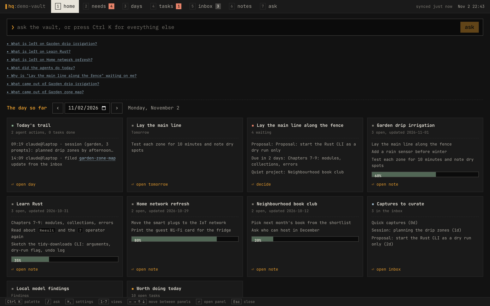
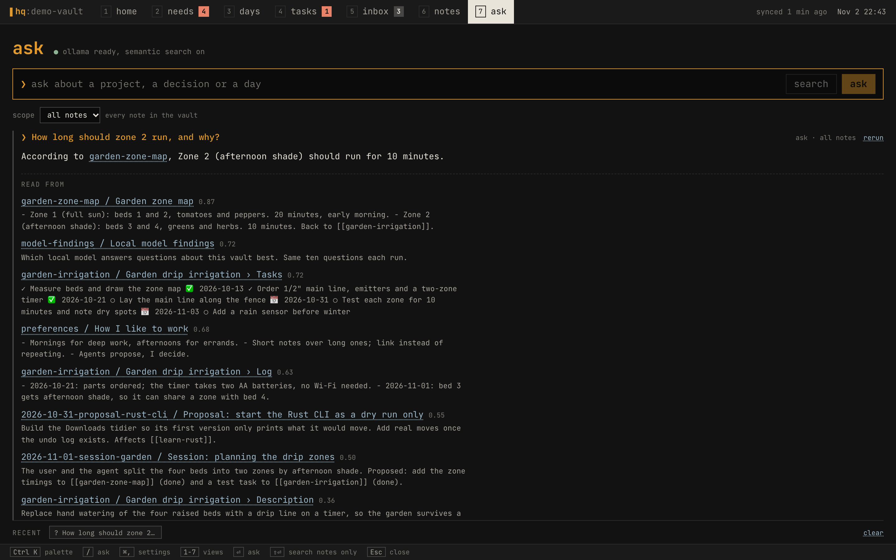
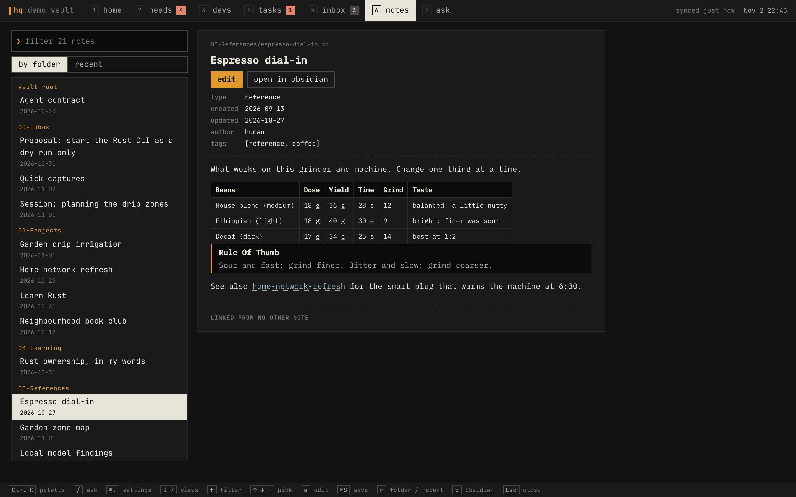
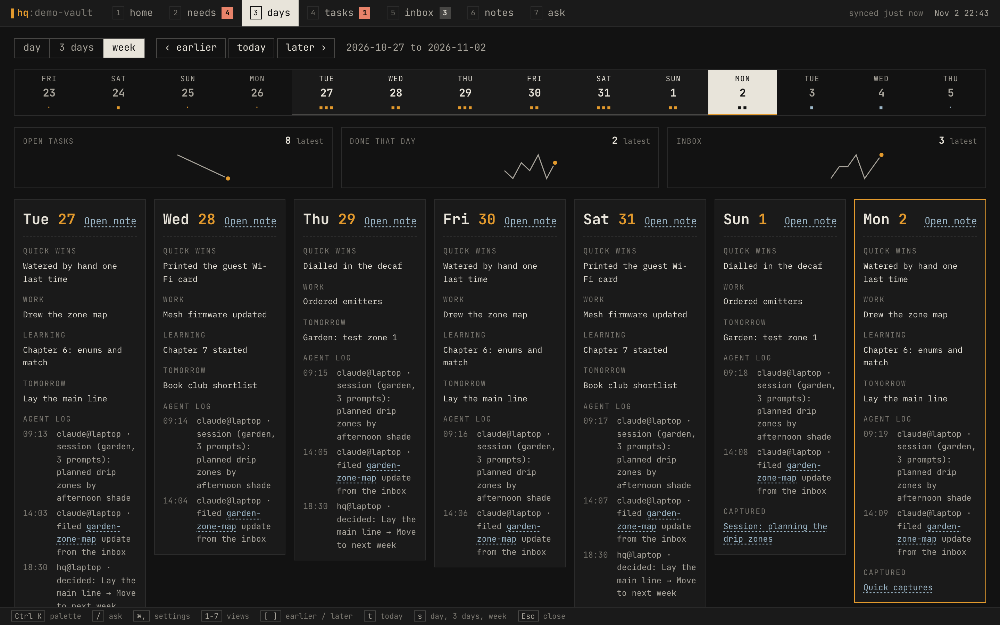
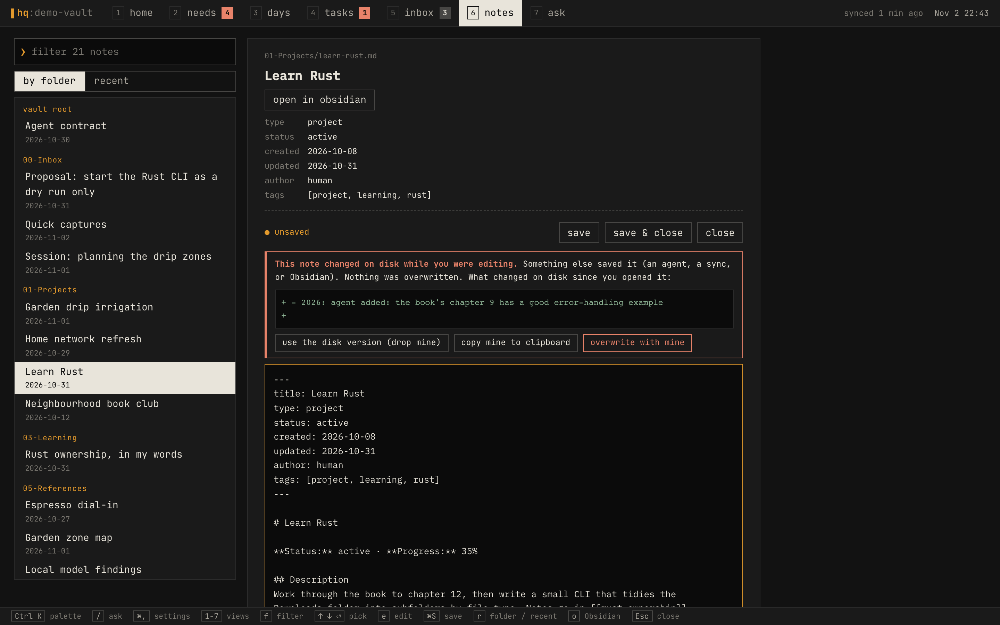
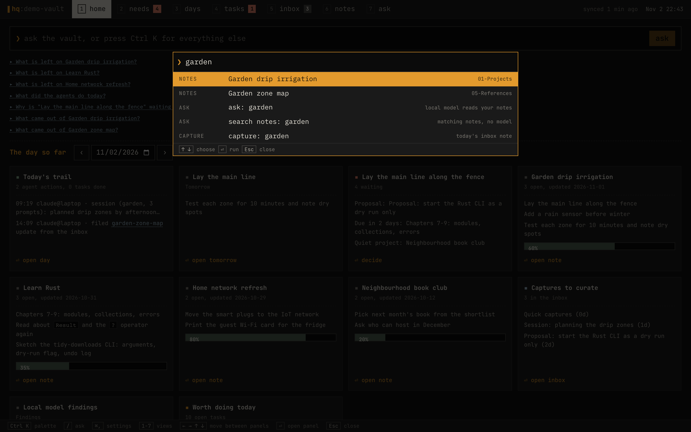
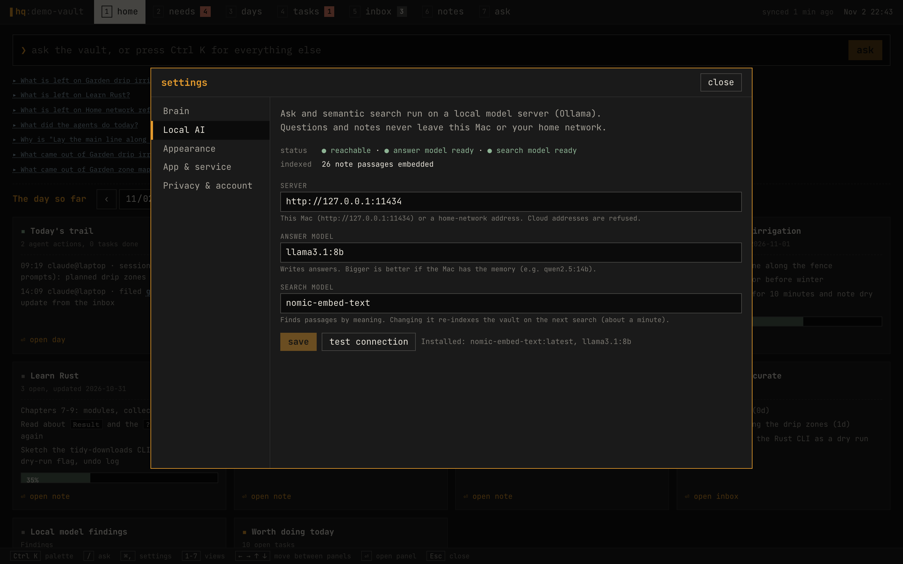

# Vault HQ

A local front end for a "second brain": a folder of markdown notes that you, your
editors and your AI agents all write into. Obsidian is fine for storing that folder
and poor for living in it, so HQ keeps the files and replaces the window: what needs
you today, your days at a glance, tasks, notes you can read and edit, and questions
answered by a model running on your own Mac. Nothing leaves the machine.



**Try it with sample data** (macOS, Node 25+; Taskwarrior and Ollama optional):

```bash
npm install
npm run demo        # builds a fictional demo vault in /Users/Shared/hq-demo, serves http://localhost:4330
```

| | |
|---|---|
|  |  |
|  |  |
|  |  |

**Status:** a personal project, built for one Mac and one vault layout (folders
`00-Inbox` … `09-Planning`, daily notes with Quick Wins, Work, Learning, Tomorrow and an
Agent log). The background automation that fills the vault (agent capture hooks, the
Taskwarrior ↔ notes sync, daily metrics) lives in the vault itself and is not published
yet; HQ runs without it, minus the sync.

A terminal-style interface: tabs with number keys on top, a key legend at the bottom, monospace type.

- **Home:** every panel at once (focus, needs, inbox, the day's trail, tomorrow, projects) under an ask prompt, with a date picker to look at any day.
- **Needs you:** a queue of decisions, each recorded with your reasoning.
- **Days:** day, 3-day and week views with a calendar strip that highlights the range, plus boxes to write your own Quick Wins, Work, Learning and Tomorrow lines.
- **Tasks and Inbox:** Taskwarrior tasks and triage inbox captures.
- **Notes:** read and edit any note inside HQ: tables, code, task lists and callouts rendered, `[[links]]` followed in place, and the notes that link back listed under each one. `e` edits the whole note, `⌘S` saves. If anything else changed the note while you typed (an agent, a sync, Obsidian), the save is refused and you see what changed and choose. Unsaved text is kept as a draft per note.
- **Settings (⌘,):** where the brain lives and what it is connected to, the local AI server and models (changeable; must stay on this Mac or the home network), theme, the app and service, and what HQ does and doesn't send anywhere.
- **Ask:** search and question your notes with **local Ollama only**; nothing leaves the machine. Scope it to all notes or a window of days; recent questions are kept in this browser and reopen with their results.
- **Ctrl K:** a command palette to jump to any view, day or note, ask, search notes, or capture a thought into today's inbox note.

Keys: `Ctrl K` palette, `⌘,` settings, `/` ask, `1`-`7` views, arrows move between Home panels and Needs items, `[` `]` `t` `s` step, jump and cycle the range in Days, `f` `e` `⌘S` `r` `o` filter, edit, save, reorder and open in Obsidian in Notes, `Esc` closes. The legend at the bottom always shows the current view's keys.

## Setup and launch

You need macOS, Node 25+, Taskwarrior and Ollama. A vault's own automation (if it has one) records which vault this Mac serves; otherwise set `VAULT_PATH` or pick the vault in Settings.

```bash
# 1. tools
brew install node task taskwarrior-tui
brew install ollama          # skip if Ollama is already running
ollama pull llama3.1:8b      # answers
ollama pull nomic-embed-text # semantic search (about 270 MB)

# 2. the vault's automation: records which vault this Mac serves, plus hooks, task sync, metrics
bash "<vault>/_tools/automation/install.sh"

# 3. the app
cd vault-hq
npm install
npm start                    # builds the web app and serves http://localhost:4320
```

Open **http://localhost:4320** and check:
- the top bar says "synced … ago";
- Ask says "Ollama ready, semantic search on".

**The Mac app:** `scripts/app.sh` builds the native app (Tauri, in `src-tauri/`) and installs it as `~/Applications/Vault HQ.app`. It needs Rust: `brew install rustup && rustup default stable`.
- A window over this same interface. Closing it hides it; HQ keeps running in the menu bar (the `▌hq` icon).
- **⌃⌥Space** from anywhere brings HQ forward with the Ctrl K palette open, and puts it away again if it is already in front.
- Opens at login (turn that off in the menu-bar menu). Links to Obsidian and the web open in their own apps.
- The vault is still served by the `local.vault-hq` service below; the app only shows it, and starts the service if it isn't answering.

**Always on:** `scripts/service.sh install` runs HQ as a LaunchAgent (`local.vault-hq`): it starts at login and restarts if it crashes, so no terminal is needed. After changing the code, `scripts/service.sh restart` rebuilds and restarts it. `status` shows whether it runs and the last log lines (`~/Library/Logs/vault-hq.log`), and `uninstall` removes it.

Without the service, `npm start` runs it in a terminal tab. To stop a copy started that way, run `lsof -ti tcp:4320 -sTCP:LISTEN | xargs kill` (without `-sTCP:LISTEN`, `lsof` also returns your browser's connections), or run another copy with `HQ_PORT=4321 npm start`.

**Development:** run `npm run dev:server` and `npm run dev:web` in two terminals; Vite on :5173 proxies `/api` to :4320. `npm run verify` (typecheck and build) is the definition of green.

## How it works

- **Which vault:** read from `~/.config/vault-automation/vault-path`, which the vault's `install.sh` writes (override with `VAULT_PATH`). Optional per-machine extras live in `server/personal.ts`, which `server/extensions.ts` loads only if the file exists. Each extra also stays off unless the vault's `_tools/automation/collectors.json` lists it.
- **Server (`server/`)**: Node 25 runs the TypeScript directly; there is no build step.
  - Only `127.0.0.1` is bound.
  - Request bodies are validated with Zod.
  - Every write needs the `X-HQ: 1` header and a same-origin `Origin`.
  - It reads the vault through a 4-second cache and never stores data of its own. The exceptions are snoozes (`hq.json`) and the embedding cache (`hq-embeddings.json`), both in `~/.local/share/vault-automation/state/`.
- **Tasks**: every change goes through the `task` CLI. Taskwarrior's on-exit hook runs the vault's `task-sync.py`, so the change reaches the note within seconds. HQ never edits checkboxes itself.
- **Your own words**: "add a line" in Days and the capture box write to the human zone on your behalf: `09-Planning/Daily/<date>.md` sections and `00-Inbox/<date>-capture.md`, both `author: human`.
- **Notes (`server/notes.ts`, `saveNote` in `server/writes.ts`)**: a link is resolved the way Obsidian does (path, then name), and only among notes the vault scan already found, so a URL can't reach a file outside the vault. Markdown is rendered as React elements, never as HTML. A save sends the SHA-256 of the text the editor started from; under the same file lock the vault's other writers use, the server refuses it if the file changed, and otherwise writes in place and bumps `updated:`.
- **Needs you**: built by fixed rules in `server/needs.ts`, with no model deciding what is urgent. Decisions are appended to `09-Planning/decision-log.md`.
- **Ask (`server/search.ts`)**:
  1. Notes are split into heading-sized chunks.
  2. Chunks are ranked by BM25 plus `nomic-embed-text` similarity. Project and reference notes are favoured over old session logs.
  3. `llama3.1:8b` answers from the top 8 chunks and cites `[[note]]` links. The sources are listed under each answer.
  
  **Search notes** returns the ranked chunks without calling the model.
- **Web (`web/`)**: Vite, React and strict TypeScript.
  - All colours, type and spacing live in `web/src/tokens.css`.
  - Dark graphite by default; a light theme only when chosen (Ctrl K, "theme"), remembered per browser.
  - Your words render in IBM Plex Mono and machine output in JetBrains Mono, mirroring the vault's human and machine zones.

## Environment

| Variable | Default |
|---|---|
| `HQ_PORT` | `4320` |
| `VAULT_PATH` | contents of `~/.config/vault-automation/vault-path` |
| `VAULT_STATE` | `~/.local/share/vault-automation/state` |
| `TASK_BIN` | `/opt/homebrew/bin/task` |
| `OLLAMA_URL` | `http://127.0.0.1:11434` |
| `OLLAMA_CHAT_MODEL` | `llama3.1:8b` (a larger model such as `qwen2.5:14b` gives better answers if the Mac has the memory) |
| `OLLAMA_EMBED_MODEL` | `nomic-embed-text` |

The three Ollama values can also be changed in Settings (⌘,); they are saved to `hq-settings.json` in the state folder. An environment variable, when set, wins and locks that field.

## Known behaviour

- **iCloud and the service:** run as a LaunchAgent, HQ is a background process, and macOS can refuse it reads of vault files that aren't pinned ("Unknown system error -11"). In Finder, right-click the vault folder and choose **Keep Downloaded**; this pins every note inside. Until then HQ skips the notes it can't read and shows "N notes unreadable" in the top bar (hover for the list). `collectors.json` is read from the local copy `install.sh` makes, so lab and NAS cards don't depend on iCloud.
- **iCloud evictions:** the first load after iCloud evicts the vault's notes takes about 2 minutes while they download again. In Finder, right-click the vault folder and choose **Keep Downloaded**. This doesn't apply to a vault in a plain local folder.
- **First Ask:** the first question after a vault change embeds the new chunks, which takes about a minute for the whole vault and seconds after that.
- **Answer quality:** an 8B model sometimes picks an older fact over a newer one. The sources under each answer show what it read; trust those over the prose.

## License

MIT, see [LICENSE](LICENSE).
